# GBA PSG Voice

A program card for the Music Thing Modular **Workshop Computer** that turns a **Game Boy Advance**
into a synth voice for your modular.

The Workshop loads custom software onto the GBA through its link cable using the GBA's built-in
**multiboot**, so you need no cartridge and no modifications. From then on, signals flow both ways:
your CV, knobs and gates play the GBA's four sound channels, and the GBA sends its notes, gates and
buttons back to the rack. Sound comes out of the GBA's headphone jack, and the sound editor is on
the GBA's own screen.

**[User manual (PDF)](docs/GBA%20Workshop%20Computer%20Card%20-%20User%20Manual.pdf)** ·
**[Technical guide](TECHNICAL.md)** ·
**[Program Card Firmware](UF2/gba_link.uf2)**

## Videos

|  |  |  |
|:---:|:---:|:---:|
| **[Quick setup guide](https://youtu.be/Y_fqK4FyiVg)** | **[Bleepy demo](https://youtu.be/Hya3-_Gx0ko)** · [walkthrough](https://youtu.be/tnnsXaU_m3g) | **[Drone-y demo](https://youtu.be/XfpNH66bNI8)** · [walkthrough](https://youtu.be/APfw5EQi4cs) |

---

## What you need

- **A Game Boy Advance, GBA SP or Analogue Pocket**, with **no cartridge in it**.
  The GBA SP has no headphone socket, so it needs Nintendo's SP headphone adapter.
- **A link cable** wired to the Workshop's pulse jacks, with two 1 kΩ resistors (see [below](#the-cable)).
- **The firmware**, [`UF2/gba_link.uf2`](UF2/gba_link.uf2), flashed to the Workshop Computer.

## Getting started

1. Connect the GBA to the Workshop with the link cable. Leave the cartridge slot empty.
2. Switch on the **Workshop Computer first**, then the **GBA**.
3. The Workshop's LEDs light in sequence as the software loads (about six seconds).
4. The GBA screen goes green, then shows the **MAIN** page.
5. Push the **Z switch down**. You should hear a note.

Sound comes from the **GBA's headphone jack**. It is quiet by Eurorack standards, so plug it into a
mixer or another input with gain.

**Nothing happening?** Power-cycle the GBA and try again. You always need to do this after
re-flashing the Workshop. For fault codes and step-by-step checks, see the
[technical guide](TECHNICAL.md#if-it-does-not-work).

## The cable

| Pin | Signal | Connect to |
|-----|--------|------------|
| 1 | VDD | nothing |
| 2 | SO | **Pulse In 1** |
| 3 | SI | **Pulse Out 2**, through a **1 kΩ resistor** |
| 4 | SD | nothing |
| 5 | SC | **Pulse Out 1**, through a **1 kΩ resistor** |
| 6 | GND | ground |

- **Don't leave out the resistors.** The pulse outputs swing to about 6 V and the GBA runs at 3.3 V.
- **Use a Game Boy Color link cable** if you can. They have all six wires; many third-party GBA
  cables don't.
- **The two ends of a link cable may swap SO and SI.** If nothing connects, the
  [technical guide](TECHNICAL.md#making-a-cable-a-word-of-warning) has a diagnostic that tells you
  which wire is which.

## Connections

| Inputs | Default job |
|---|---|
| **CV In 2** | 1V/oct pitch |
| **CV In 1** | unassigned |
| **Audio In 1 / 2** | unassigned |
| **Pulse In 2** | gate / trigger (tick **PU2** on the TRIG page) |
| **Pulse In 1** | GBA SO (link cable) |
| **Main knob** | channel 3 level |
| **X / Y knobs** | attack / release |
| **Z switch** | down = trigger, up = assignable modulation |

| Outputs | Job |
|---|---|
| **CV Out 1** | gate out |
| **CV Out 2** | pitch out (quantised, 1V/oct) |
| **Audio Out 1** | **A** button gate |
| **Audio Out 2** | **B** button gate |
| **Pulse Out 1** | GBA SC (link cable) |
| **Pulse Out 2** | GBA SI (link cable) |

You can reassign every input, knob and the switch on the GBA's **MAP** page.

---

## The GBA software

| Button | Does |
|---|---|
| **START** | open the editor / back to the MAIN page |
| **SELECT + Left/Right** | move between editor pages |
| **D-pad** | move around a page |
| **A + D-pad** | change a value |

### MAIN

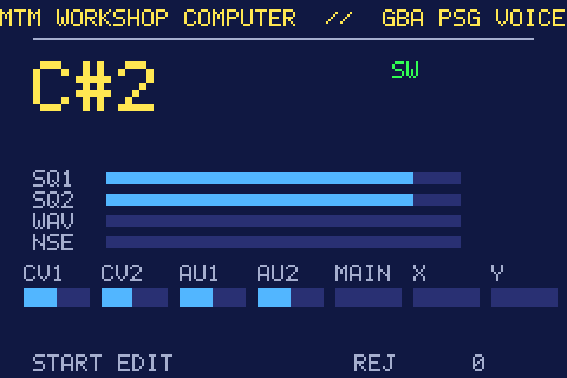

The performance screen. It shows the note playing, the level of each of the four sound channels
(SQ1, SQ2, WAV, NSE) and the live inputs and knobs. Here the **D-pad, A, B and shoulder buttons**
are for playing: trigger, hold, ornaments and more, all set on the BTN page.

### MEM: patch memory

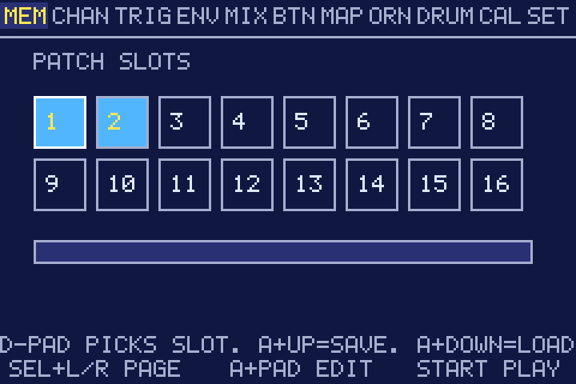

Sixteen patch slots, stored on the Workshop Computer. **D-pad** picks a slot, **A + Up** saves,
**A + Down** loads.

> ⚠️ Saving overwrites the slot straight away. Check you are on the right slot first.

### CHAN: channels

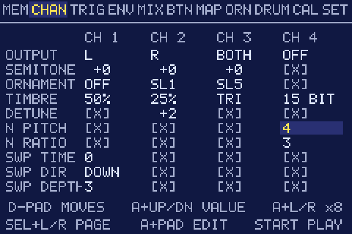

The core sound of each of the four channels: output (left / right / both / off), semitone offset,
ornament, timbre (duty cycle or waveform), detune, noise pitch, and channel 1's pitch sweep.

### TRIG: triggers

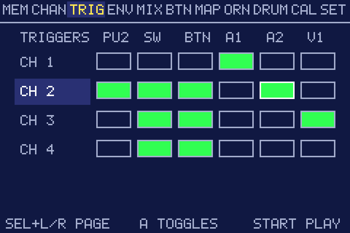

What fires each channel. Tick any combination of Pulse In 2, the Z switch, a GBA button,
Audio In 1, Audio In 2 and CV In 1.

### ENV: envelopes

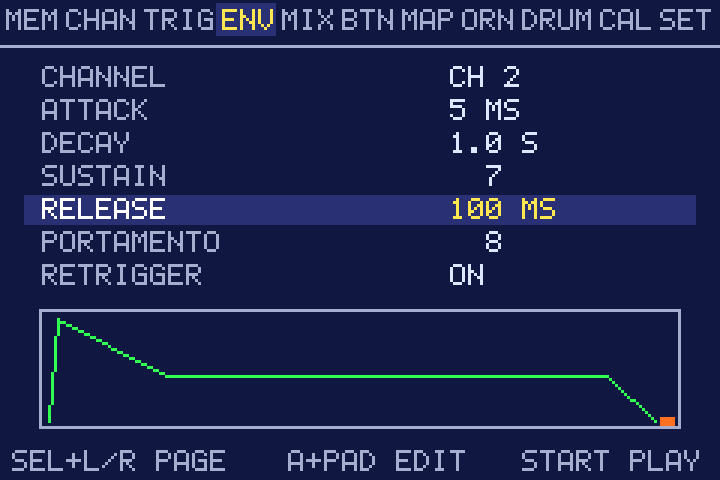

Attack, decay, sustain and release for each channel, plus portamento and retrigger. The shape is
drawn as you edit it.

### MIX: mixer

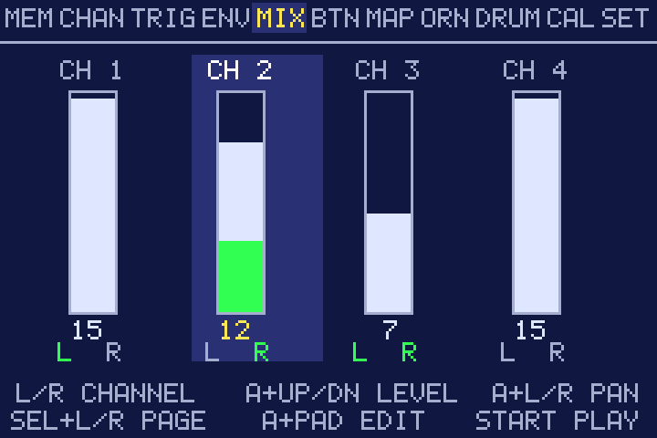

Level (0–15) and left / right panning for each channel.

### BTN: buttons

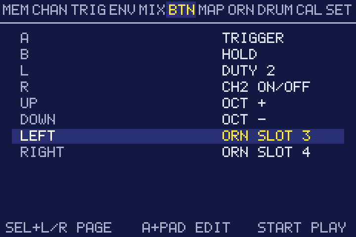

What each GBA button does on the MAIN page: trigger, hold, octave up/down, duty cycle, ornament
slots, channel on/off and more.

### MAP: modulation

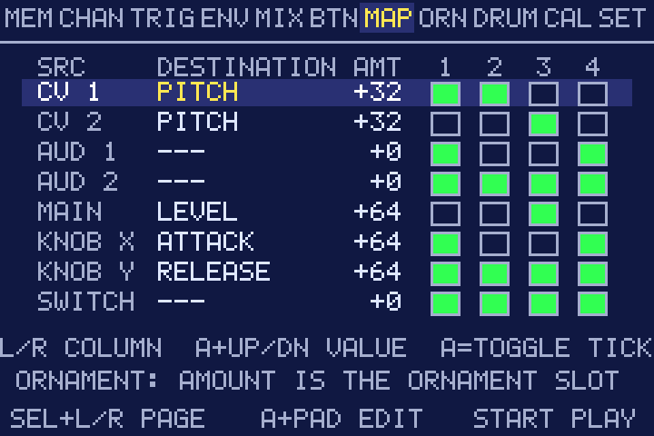

The modulation matrix. Each source (CV 1, CV 2, Audio 1, Audio 2, the three knobs and the switch)
gets a destination, an amount, and a tickbox per channel. An amount of +32 on PITCH is exactly
1V/oct.

### ORN: ornaments

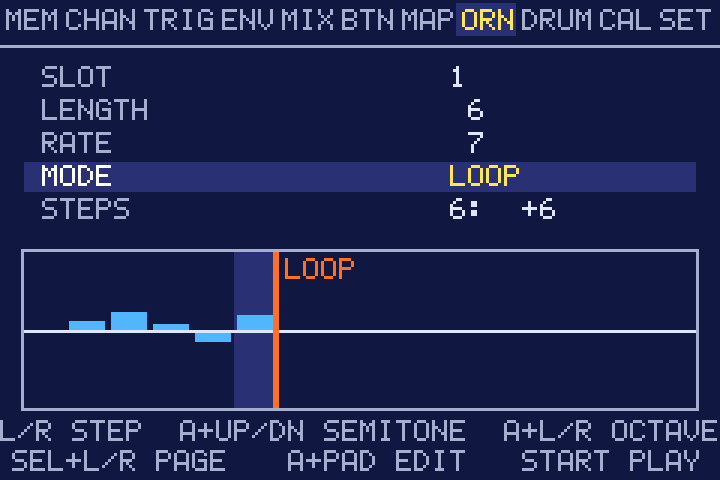

Six arpeggios or pitch sequences of up to sixteen steps. Set the length, rate and mode (loop, or
play once), then draw the steps.

### DRUM: drum mode

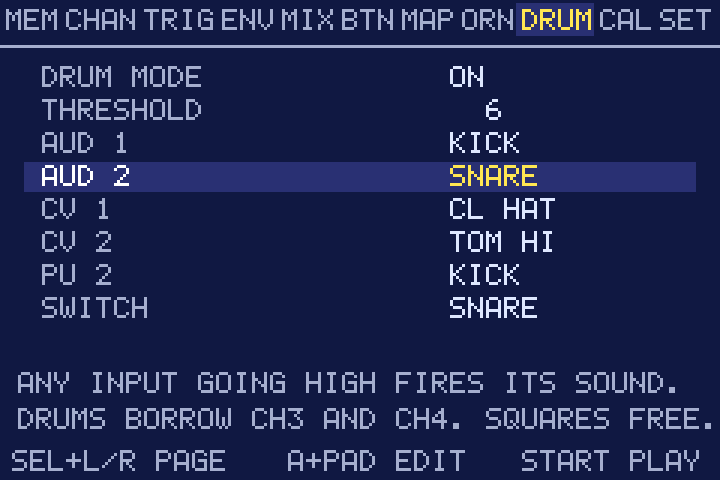

Turns incoming triggers into percussion on channels 3 and 4, leaving the two squares free for
melody. Pick a sound for each input (kick, snare, hats, toms, clap and more) and set the threshold.

### CAL: calibration

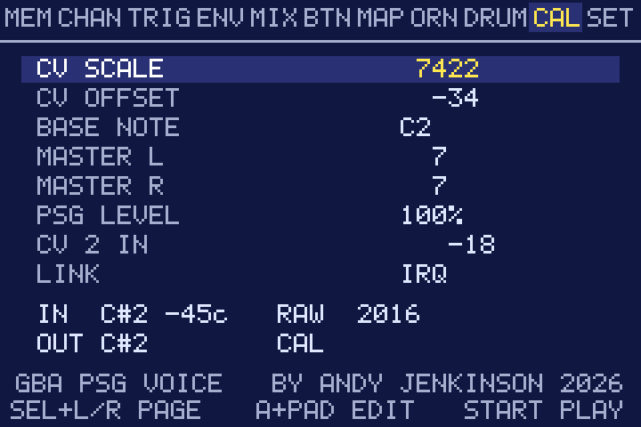

Trims how CV In 2 tracks 1V/oct (CV scale, offset and base note), and sets the master levels. The
live tuner at the bottom shows the incoming note and the note being played, so you can trim until
they match. **You may need this page:** every Workshop Computer's inputs are slightly different.

### SET: settings

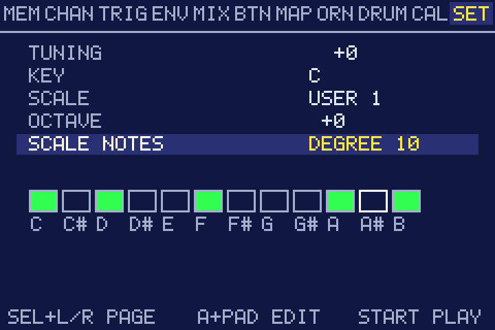

Master tuning, key, scale and octave. Choose a scale to quantise everything you play, and CV Out 2
becomes a quantiser for the rest of your rack. **FREE** turns quantising off. Four user scales can
be edited note by note.

---

## More

- **[Technical guide](TECHNICAL.md)**: building the cable in detail, fault codes, every page in
  depth, how the link works, and how to build from source.
- **[BENCH.md](BENCH.md)**: step-by-step bring-up if it doesn't connect.
- **[diagnostics/](diagnostics/)**: link and cable test programs.

By **Andy Jenkinson** (YT/IG @uglifruity), 2026. Built on
Chris Johnson's ComputerCard library for Tom Whitwell's Music Thing Modular Workshop Computer.
MIT licensed.
