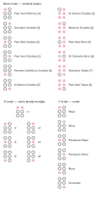

**The Bells / Program Card V1**

A bellringing methods sequencer by James Saunders

**What is The Bells card?** 

The Bells is a sequencer that provides 12 bell ringing methods with tempo and jitter controls, quantised to six different scales.

It sends a v/oct pitch sequence and synchronised pulse to control the oscillators or other inputs that could respond to permutation patterns, and optionally plays the methods using bell samples.

Its parameters are controllable during playback and in a setup mode, accessible by holding Z down while turning a knob. Z switches between play, stop and edit modes. 

**About**

This is a port from a prototype Eurorack module I’ve been working on over the last year. It has some additional functionality (8 gates to cue a sampler, more methods, pitch selection), but otherwise the Workshop System version is very similar. I originally made the module as my first attempt at hardware development, having been ringing bells for the past two years, and also having an obsession with permutation patterns. 

I would love to hear what anybody does with this, so please send me anything you make. Also, new feature suggestions are always welcome, as are any information about errors. 

More information on bell ringing: [change ringing](https://en.wikipedia.org/wiki/Change_ringing) / [methods diagrams](https://fortran.orpheusweb.co.uk/Bells/Diagrams/IndPDF.htm)

For questions or support, email [jamessaundersalloneword@gmail.com](mailto:jamessaundersalloneword@gmail.com) or visit [www.james-saunders.com](http://www.james-saunders.com)

**CONTROLS**

| Z | UP: play MIDDLE: stop DOWN (hold): edit  |  |  |  |
| :---- | :---- | :---- | :---- | ----- |
|  | PLAY/STOP MODES |  | EDIT MODE   |  |
| MAIN | Changes raw tempo from 5-300 BPM |  | Select method  |  |
| X | Sets jitter between 0-40% of  |  | Select clock divide amount from /8 to x8  |  |
| Y | Turns covering tenor off (CCW-12) or on (12-CW) for odd-bell methods |  | Select scale (1-6, set in the web editor) |  |
|   **LEDs**  |  |  |  |  |

**WEB EDITOR**

From v1.2 the twelve method slots can hold any method, up to Maximus (12 bells). Connect the card by USB, open the editor in Chrome or Edge and click *Connect to card*.

- **The Library** holds the Central Council (CCCBR) method collection — over 22,000 methods. Commonly rung methods are listed first; the rest follow by the year of their first tower peal. Search by name, or filter by number of bells and kind (Bob, Surprise, Delight, Treble Bob, Place).
- **Write your own** takes any place notation, e.g. -16-16-16,12 for Plain Bob Minor.
- Click a method to see its plain course with the treble and any other bell's line drawn through it, and a check that its lead head matches the CCCBR record. Then *Write into slot*.
- *Choose on the card* does the same as Z down + Main. While the card is ringing, the editor follows the current row.
- Methods are stored on the card once it is stopped. *Save to file* / *Load from file* keep sets of twelve.

The card rings each method from rounds, lead after lead, until it comes back to rounds (the plain course), then starts again. Bells 1–6 play the recordings; bells 7–12 and the covering tenor sound on CV Out 1 and Pulse Out 1 only.

**SCALES**

The six scales chosen with Z down + Y can be changed in the web editor (*The Scales*). The factory scales are the original six — Major, Minor, Pentatonic major, Pentatonic minor, Blues, Chromatic — with the tenor on C4 (0 V).

- **From the library**: over 40 scales and modes (church modes, harmonic and melodic minor, diminished, whole tone, Japanese pentatonics, Hungarian minor, double harmonic, arpeggios, stacked fourths and fifths, the harmonic series…) on any tenor note.
- **Your own**: type the pitches from the tenor up, e.g. `C#5 E5 G#4 Bb3` (C4 = middle C = 0 V). They needn't go upwards. Choose what happens when a method has more bells than pitches: start again an octave higher, higher by any number of semitones, or round again at the same pitches.
- The editor shows the pitch and voltage of every bell for any number of bells, and *Hear rounds* plays it.

Scales change CV Out 1 only; the recorded bells keep their own pitch.

**UPDATES**

v1.4 (11.11.26)
- The six scales can be set from the web editor: any library scale on any note, or your own list of pitches. The factory scales are unchanged.

v1.3 (11.11.26)
- Fixed repeated pitches on 12 bells: the scales now extend upwards for as many bells as needed, so every bell has its own pitch.
- The covering tenor (Y) is now only rung behind methods on an odd number of bells (Doubles, Triples, Caters, Cinques), as in ringing. Even-bell methods such as Minor and Maximus ring without it.

v1.2 (06.11.26)
- Any method in any of the twelve slots, set from the web editor. The card controls are unchanged.
- The factory slots are the same twelve methods, now stored as place notation and checked against the CCCBR collection. Reverse Canterbury Pleasure Place Doubles is corrected: the old version came back to rounds one row early.

v1.1 (30.06.26)
- First main update adds sampled bells from my local tower, recorded last night wiht thanks to Will Rogers. Patch audio out 1 and 2 to the mixer (either channels 1 and 2 pr use a stackable to send them to the same channel), or via processing. Select the method in the normal way and click Z up to play the chosen methd with sampled bells. The tempo, jitter and covering tenor settings all work, but the scale has no effect (samples, not CV). Note it only currently works with six bells as our twoer is only a ring of six - I'll record a ring of eight when I get a moment so all the methods will work.
- Corrected some errors in the methods.

Some sound recordings are now on discord here: https://discord.com/channels/1210238368898879569/1520571591711391754

After playing part of a sequence and then stopping it, flipping the Z switch up to start it will continue from where it left off. To restart from the beginning (the descending scale) flip it down to the edit mode and release, and then it will reset.

After editing and then playing the sequence, it will use the current knob positions. So for example if you chose pattern 12 (CCW) the tempo will be fast, and if you altered the clock divider it may use some jitter. Just move the knobs where you want them before pressing start so it does what you want. One slightly confusing thing is with the tempo/pattern knob - if you turn it full CCW to select pattern 1 then play, it will sound like it has frozen, but it's just moving at a VERY slow tempo (possibly down to 0.6 BPM!) Just whack up the tempo knob and restart to get it moving.
