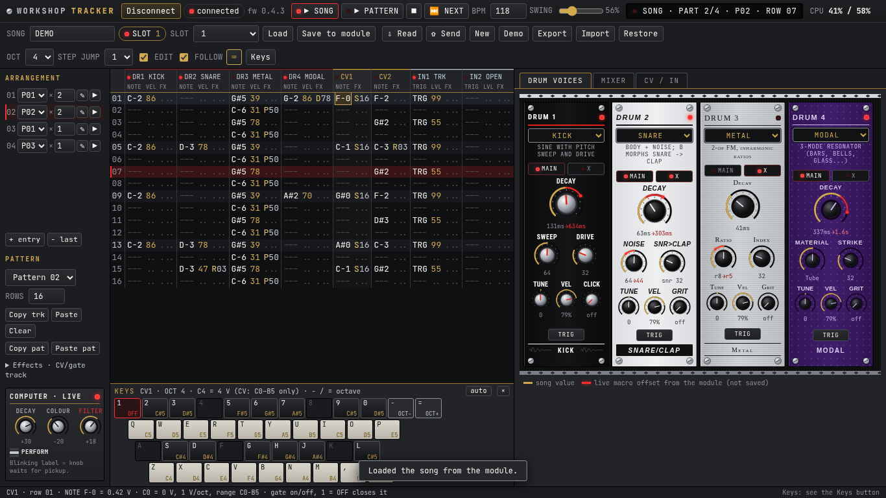
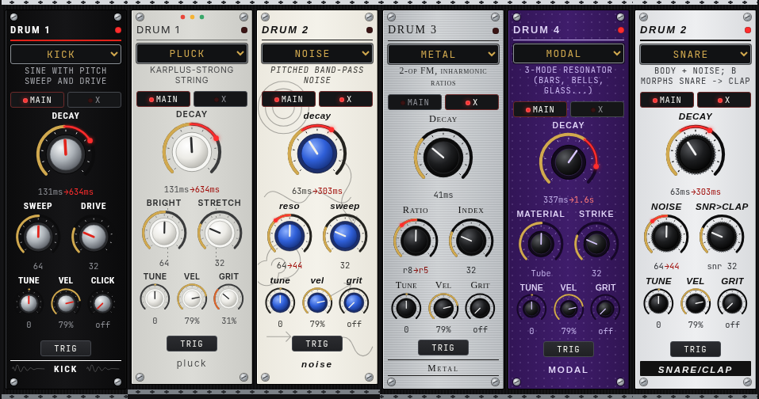
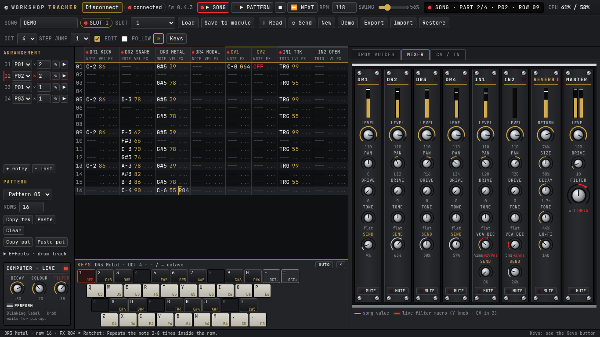
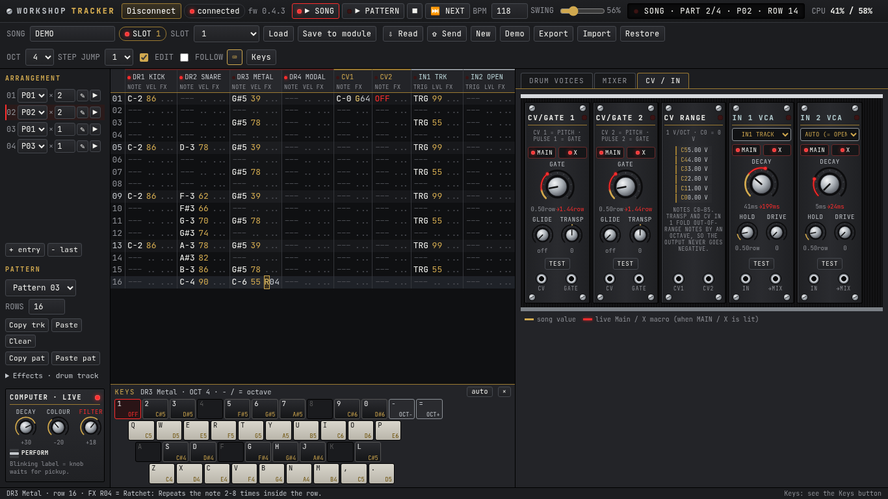

# Computer Tracker

**▶ [Open the web app](https://gordonbleu-modular.github.io/computer-tracker/)** (Chrome or Edge) · [Download the firmware](https://github.com/gordonbleu-modular/computer-tracker/releases)

A **tracker sequencer with four drum-synth voices** for the
[Music Thing Modular Workshop System](https://www.musicthing.co.uk/workshopsystem/)
**Computer** module, plus a **browser editor** that controls it over USB.

* **4 drum voices on the module**, each one of six engines: Kick, Pluck,
  Noise, Metal, Modal, Snare/Clap.
* **2 CV/gate tracks** that play the Workshop System's two analogue VCOs
  (1 V/oct on CV out 1/2, gates on pulse out 1/2).
* **Audio in 1/2** bring the VCOs back into the mix through a VCA each,
  played by their own **IN tracks**.
* A **stereo mixer** with a **lo-fi reverb** on a send, out on audio out 1/2.
* **16 patterns × 64 rows × 8 tracks**, one effect per step, a song
  arrangement, tempo and swing. All values are typed as **00–99**.
* **Plays without a computer**: 6 song slots in flash, start / next part /
  stop, knob macros, external clock and reset.

## Quick start

1. **Flash the card:** with the card in the Computer and USB plugged in, hold
   the BOOTSEL button (behind the main knob), tap the reset button and drag
   `workshop_tracker.uf2` (from [Releases](https://github.com/gordonbleu-modular/computer-tracker/releases) or `dist/`) onto the `RPI-RP2` drive
   ([official guide](https://www.musicthing.co.uk/workshopsystem/program-cards/install/)).
2. **Patch:** audio out 1/2 → headphones or mixer (L/R). For the VCOs see
   [Audio routings](#audio-routings-with-the-two-vcos).
3. **Open the editor** in Chrome or Edge (WebMIDI with SysEx):
   <https://gordonbleu-modular.github.io/computer-tracker/> (or locally: `cd web && python3 -m http.server 8000`
   → <http://localhost:8000>).
4. **Connect** and allow MIDI/SysEx. Edits play on the module at once;
   **Save to module** stores the song in the selected slot.
5. Unplug USB whenever you like: the module keeps playing from its panel.

The editor also works offline; songs can be exported as `.wtrk.json`.

## The module on its own

| Z | Main | X | Y |
| --- | --- | --- | --- |
| **Middle** (PERFORM) | decay macro (drum voices routed to MAIN, CV gate length, IN VCA decay) | colour macro (param A of the voices routed to X, CV glide, IN drive) | master filter: left low-pass, right high-pass |
| **Up** (SELECT) | song slot (the knob travel is split over the saved slots) | tempo 40–240 BPM | swing 50–75 % |
| **Down** (push) | tap: start / next song part · hold 0.8 s: stop | | |

Macros are **offsets** on top of the song: never saved, back at noon = the
song as programmed. Which voices they reach is set with the **MAIN** / **X**
buttons on each module in the editor. Knobs use soft takeover. Pulse in 1 is a
clock input (1 pulse = 1 row), pulse in 2 resets, CV in 1 transposes both CV
tracks, CV in 2 moves the master filter. On power-up the last slot is loaded,
stopped. Full control map and LEDs: [docs/CONTROLS.md](docs/CONTROLS.md).

## Drum voices

Each drum module picks an engine; its faceplate changes with it. All
modules have the same knobs:

| Knob | What it does |
| --- | --- |
| **Decay** | length of the sound |
| **A**, **B** | two sound parameters, different per engine (below) |
| **Tune** | ±48 semitones on top of the note in the grid |
| **Vel** | velocity sensitivity, see [Velocity](#velocity) |
| **Click / Grit** | Kick: beater click. All other engines: grit. 0 = off |
| **MAIN / X** | whether the Main / X macro reaches this voice |
| **TRIG** | plays the voice once |

| Engine | Sound | A | B |
| --- | --- | --- | --- |
| **Kick** | sine with a falling pitch sweep and soft-clip drive | **Sweep**: depth of the pitch drop | **Drive**: saturation |
| **Pluck** | Karplus-Strong plucked string | **Bright**: brightness of the pluck | **Stretch**: low = dark and damped, high = bright and stretched |
| **Noise** | noise through a resonant band-pass tuned to the note | **Reso**: from hiss to whistle | **Sweep**: how far above the note the filter starts before it falls to the note |
| **Metal** | 2-operator FM with inharmonic ratios: bells, cowbells, metallic hats | **Ratio**: 16 frequency ratios | **Index**: FM amount (brightness) |
| **Modal** | short strike into three tuned resonators | **Material**: Membrane, Marimba, Glock, Bell, Tube, Plate, Glass, Gong | **Strike**: hardness of the strike |
| **Snare** | sine body with pitch drop plus noise, morphing into a clap | **Noise**: noise against body | **Snr>Clap**: snare → clap morph |

**Kick: Click.** A short (≈ 1.5 ms) beater click on top of the kick: high-passed
noise and a 1.6 kHz blip, louder with the step velocity, through the kick's
drive. Listen: [kick_click.wav](docs/audio/kick_click.wav).

**Snare: snare → clap.** B up to 44 is the snare (brighter to the right), from
84 on the clap (three noise bursts, further apart to the right). In between
the two blend smoothly: the noise colour slides and the clap's extra bursts
fade in. Listen: [snare_clap_morph.wav](docs/audio/snare_clap_morph.wav).

**Grit** (Pluck, Noise, Metal, Modal, Snare). A lo-fi fuzz on the voice
output: drive into a hard clip, fewer bits and, from 25 % on, a lower sample
rate (down to 12 kHz). It makes a voice louder (up to ≈ +10 dB), so turn its
mixer level down. Listen: [grit_demo.wav](docs/audio/grit_demo.wav). Grit on
one or two voices is fine; grit on all four in a very dense pattern with lots
of reverb can make the module crackle.

## Mixer and reverb

Channels DR1–DR4, IN1, IN2: **level, pan, drive, tone** (left darker, right
thinner, centre flat), **send** to the reverb and a **mute**. IN channels also
have their VCA (see below). The master has a filter (Y knob) and drive. The
REVERB and MASTER strips have live mute switches (not saved).

The **lo-fi reverb** is a deliberately grainy stereo reverb:

| Knob | What it does |
| --- | --- |
| Return | wet level into the master (≈ 71 % = 0 dB) |
| Size | room size; turning it bends the tail's pitch a little, like tape |
| Decay | 0.3–9 s |
| Tone | dark … bright tail |
| Lo-fi | clean … gritty: fewer bits, a slow wobble, from 50 % sample-and-hold |

Listen: [demo_dry.wav](docs/audio/demo_dry.wav) and
[demo_reverb.wav](docs/audio/demo_reverb.wav).

## Audio routings with the two VCOs

| Jack | Function |
| --- | --- |
| CV out 1 / 2 | pitch of CV track 1 / 2, 1 V/oct, **C-0 = 0 V … B-5 = 5.92 V** (the octave digit is the voltage) |
| Pulse out 1 / 2 | gate of CV track 1 / 2 |
| Audio in 1 / 2 | mixer channels IN1 / IN2, each through a VCA |
| CV in 1 | transposes both CV tracks (1 V/oct, folded back by octaves, never below 0 V) |
| CV in 2 | added to the master filter |
| Pulse in 1 / 2 | clock (1 pulse = 1 row) / reset |

**Basic patch:** CV out 1 → VCO 1 pitch, CV out 2 → VCO 2 pitch, VCO 1 out →
audio in 1, VCO 2 out → audio in 2. The **CV / IN** tab sets how each input's
VCA opens:

* **CV GATE**: the VCA follows the gate of CV track 1 / 2, so the VCO sounds
  only while its note plays. The simplest way to a bass or lead line.
* **IN TRACK**: the VCA is played by its own track (IN1 / IN2): TRIG opens it,
  LVL sets the level, with hold (G), decay (D), ratchets, probability. The VCO
  can drone while the IN track chops it into rhythms, independent of the
  melody on the CV track.
* **OPEN**: always on, e.g. for a drone, or when an envelope and VCA elsewhere
  in the System do the shaping.

Per CV track the CV / IN tab also has **gate length, glide, transpose**, per
input **decay, hold, drive** and the MAIN / X macro routing.

**Ideas:**

* Pulse out 1/2 → an envelope in the System, shaping the VCO through the
  System's filter or VCA before it comes back into audio in 1/2: the module
  becomes sequencer and mixer for a fully analogue voice.
* Both VCOs on the same CV out (CV out 1 to both pitch inputs with a stackable
  cable) and slightly detuned: one fat voice, IN1 and IN2 panned left and right.
* CV track 1 as a bass line with VCA source CV GATE, CV track 2 as a lead with
  `S` slides and its VCA played by the IN2 track as rhythmic stabs.
* Send IN1/IN2 into the reverb with the `W` effect only on single hits for
  dub-like throws.
* A slow LFO or random voltage into CV in 1 transposes the CV tracks; into
  CV in 2 it sweeps the master filter.
* An external clock into pulse in 1 syncs the tracker to the System (one
  pulse per row, swing still applies).

## The tracker grid

Columns: drum tracks **NOTE VEL FX**, CV tracks **NOTE FX**, IN tracks
**TRIG LVL FX**. `..` = default. Note `OFF` (key `1`) chokes a drum, closes a
CV gate or an IN VCA. Under the grid a keyboard sketch shows which computer
key plays which note (piano layout on `Z S X D C…` and `Q 2 W 3 E…`, also on
QWERTZ). **Keys** in the editor lists every shortcut.

### Step effects

Every step has **one effect**: a letter and a value 00–99. Type the letter
in the FX column or press Enter for a list; the status line explains it.

| FX | Tracks | Value | What it does |
| --- | --- | --- | --- |
| `A` | drum | 00–99 | **Param A** for this hit only (Sweep, Bright, Reso, Ratio, Material, Noise) |
| `B` | drum | 00–99 | **Param B** for this hit only (e.g. snare ↔ clap per hit) |
| `D` | drum, IN | 00–99 | **Decay** for this hit only (IN: VCA release) |
| `G` | CV, IN | 00–64 | **Gate length** in 1/16 row: 08 = half a row, 16 = one row, 64 = four rows, 00 = hold until the next note or OFF |
| `S` | CV | 00–99 | **Slide**: glide to this note in the given time (up to ≈ 2 s); the gate stays high (legato) when the previous note is still on |
| `R` | all | 02–08 | **Ratchet**: the note repeats 2–8 times inside the row (CV/IN gates: half of each repeat) |
| `P` | all | 00–99 | **Probability** in % that the step plays (00 = never; no P = always) |
| `K` | all | 01–15 | **Delay**: plays the step n/16 of a row late (08 = half a row, off-beat) |
| `W` | drum, IN | 00–99 | **Reverb send** for this hit instead of the Send knob (50 ≈ −12 dB, 99 = full); the hit's tail keeps it, the next hit without W goes back to the knob |

Panel macros add on top of `A` and `D` locks just like on the knob values.

### Velocity

* **VEL column (drum tracks):** how hard the step is hit, 01–99;
  `..` = 79 (the default hit).
* **Vel knob (on each drum module):** how much the VEL column changes the
  loudness: `level = 127 − (127 − VEL) × Vel / 128` (in the internal 0–127
  scale). **0 %** = every hit at full level (VEL ignored), **100 %** = VEL sets the level
  fully; default 79 %. For example a kick at 0 % always hits full while hats at
  100 % follow their accents. Velocity also scales the Kick's click.
* **LVL column (IN tracks):** the VCA level of that trigger, `..` = full.
* **CV tracks** have no velocity: a gate is on or off. An IN VCA that follows
  the CV gate opens fully; the mixer level sets the volume.

## More

Protocol and song format: [docs/PROTOCOL.md](docs/PROTOCOL.md) · CPU load:
[docs/CPU_BUDGET.md](docs/CPU_BUDGET.md) · panel details:
[docs/CONTROLS.md](docs/CONTROLS.md).

## License

MIT, see [LICENSE](LICENSE). ComputerCard is MIT © Chris Johnson
(`vendor/ComputerCard/LICENSE`).
