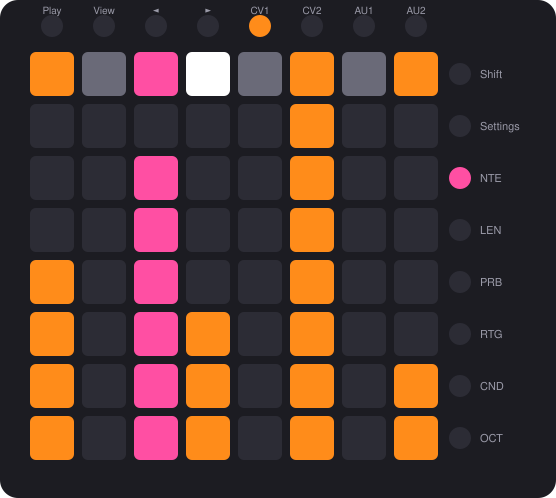
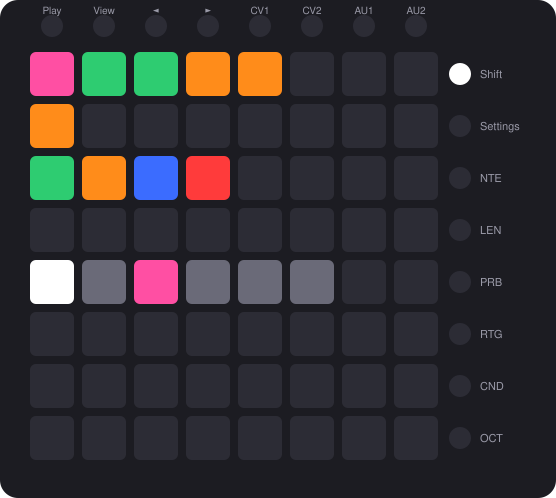

# Blocks

Blocks turns a **Novation Launchpad** into a four-track step sequencer for the Music Thing Workshop System Computer.
Two tracks send pitch and gate, two send stepped CV. Every step has five lanes (note, length, probability, ratchet,
condition), an octave on the CV tracks, and a **microtiming** nudge for feel and flams. Sixteen patterns can be chained,
and a pattern switch waits for the longest track loop, so tracks of different lengths make polyrhythms. Everything saves
to the card by itself. Inspired by the OXI One, Squarp Hapax and drumdrum.

**[Web editor and manual](https://computer.musicthing.co.uk/programs/80-blocks/web/index.html)** · **[Changelog](CHANGELOG.md)**

## What you need

- A Workshop System Computer with the Blocks card.
- A Launchpad Mini MK3 (verified). Launchpad X and Pro MK3 are supported but not yet tested on hardware. The Computer powers it over USB.
- For the web editor (optional): a computer with Chrome or Edge.

## Quick start

1. **Flash the card.** Press **Connect workshop computer** at the top of this page, or download the firmware and copy the `.uf2` onto the card in programming mode.
2. **Plug in the Launchpad.** Use the Computer's front USB-C, then power on or press Reset. BLOCKS scrolls across the pads, then the grid appears. The Novation logo pulses to the beat.
3. **Patch a voice.** **CV Out 1** to a VCO's pitch, **Pulse Out 1** to an envelope.
4. **Play.** Tap a few steps on the top pad row, tap pads below them to set each step's note, then press **Play** (top-left button).
5. **Keep going.** The [web editor](https://computer.musicthing.co.uk/programs/80-blocks/web/index.html) holds the full manual and works without a card connected.

## The grid

The picture at the top is the Focus view: the top row is the gates of 8 steps, and the rows below show the selected lane (here notes) as bars.

Patterns screen: 16 slots on the top two rows, the **N**ew, **A**ppend, **I**nsert and **D**elete chain pads, and the chain page below.

## What it does

- **Four tracks.** CV1 and CV2 send pitch and gate; AU1 and AU2 send stepped CV or triggers. Each step has five lanes with seven levels each, and an octave
  (−2…+2) on the CV tracks. Each track has its own length (up to 64 steps), clock division, direction, scale, root and range or output type.
- **Microtiming.** Push any step up to 11/24 of a step early or late with the Y knob (Z in the middle), for flams and laid-back feel.
  Early and late steps are tinted on the gate row.
- **Swing.** Live on the Y knob in perform (Z up), 50-71 %.
- **16 patterns, chains and polyrhythms.** Tap a slot to queue it; hold one and tap others to chain up to 32 in any order. Switches and chain steps happen at the end of the
  **longest** track loop: with CV1 at 16 steps and CV2 at 8, CV2 plays its loop twice first. Hold the red **D** pad and tap slots to empty those patterns and remove them from the chain.
- **Clock.** Internal (BPM on the Main knob in both Z positions, 80-180 by default) or external on Pulse In 1 (1, 2, 4, 24 or 48 PPQN, set in the editor). Pulse In 2 resets. CV In 1 and 2 transpose the CV tracks.
- **Saves itself.** A few seconds after Stop.
- **Web editor.** Connect the Computer to a computer instead of the Launchpad, power-cycle (Reset alone may not be enough), and open the editor in Chrome or Edge.
  It backs up and restores everything, and sets six options with no Launchpad gesture: external clock PPQN, CV In modes, auto-save, AU range, gate mode and BPM range.

## Status

Beta. Verified on hardware with a Launchpad Mini MK3, including microtiming, the Delete pad, switching at the longest loop and the logo pulse.
Not yet tested on hardware: the Launchpad X and Pro MK3, the external clock and reset inputs (including the PPQN setting), and a non-Novation
USB MIDI device being ignored.

## Credits and licence

MIT licence. Blocks builds on ComputerCard (Chris Johnson), usb_midi_host (rppicomidi), TinyUSB (Ha Thach) and the
Raspberry Pi Pico SDK, and adapts drumdrum (Moses Hoyt), Simple MIDI (Tom Whitwell, Chris Johnson) and the
ComputerCard web_interface example. The full list is in `CREDITS.md`.
